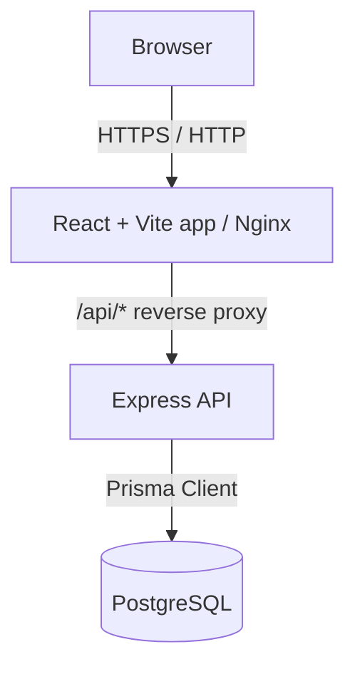
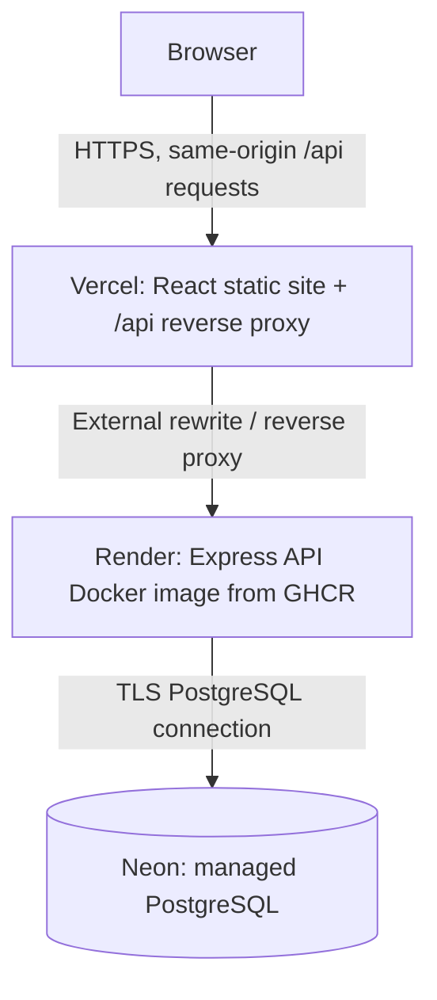

# CampusHub — Full-Stack Student Portal

> **Purpose:** A portfolio-sized, realistic full-stack application that demonstrates React + TypeScript, Express + TypeScript, PostgreSQL + Prisma, role-based access control, Docker/Compose, automated testing, GitHub Actions CI/CD, a public GitHub repository, and a live hosted demo.
>
> **Build style:** AI-assisted implementation with OpenCode. The model writes most of the code in small, reviewable milestones. The developer runs the application, checks the behavior, reviews the important decisions, and understands the architecture before moving on.

---

## 1. Project brief

Build **CampusHub**, a small university student portal for one fictional institution. It has three roles:

- **Administrator** — manages users, instructors, courses, and course assignments.
- **Instructor** — manages assigned courses, creates assignments, reviews submissions, gives grades/feedback, and posts announcements.
- **Student** — browses available courses, enrolls/drops courses, views their timetable, submits assignment work, sees grades, and reads announcements.

The system should feel like a coherent, usable application rather than a collection of disconnected CRUD screens. It should be small enough for one developer to build and maintain, but substantial enough to discuss architecture, data relationships, authorization, validation, tests, containerization, and CI/CD in an interview.

### Product boundaries

**Included in the MVP:**

1. Authentication and role-based authorization.
2. Role-specific dashboards.
3. User management for administrators.
4. Course creation and instructor assignment.
5. Course browsing, enrollment, and dropping for students.
6. Student course timetable.
7. Assignment creation by instructors.
8. Text-based assignment submissions by students.
9. Grading and feedback by instructors.
10. Global and course-specific announcements.
11. Search/filtering and pagination for relevant lists.
12. Automated tests, Docker Compose, and GitHub Actions.
13. A public GitHub repository and a live, HTTPS-hosted demo with automated deployment after successful CI.

**Explicitly excluded from the MVP:**

- Tuition/payment processing.
- File uploads or document storage.
- Live chat, messaging, or video calls.
- Attendance tracking.
- Exams, quizzes, question banks, and proctoring.
- Parent/guardian accounts.
- Multiple institutions/tenants.
- Microservices, Kubernetes, Redis, message queues, and elaborate event-driven architecture.
- A complex calendar integration.

Do not add excluded features just because they seem impressive. A well-finished small application is more valuable than a half-finished large one.

---

## 2. Technology choices

Use one consistent toolchain. Do not replace libraries or introduce new infrastructure without explaining the reason and getting approval.

### Frontend

- React with TypeScript.
- Vite for development and production builds.
- React Router for client-side routing.
- Material UI (MUI) for a consistent, responsive interface.
- TanStack Query for server-state fetching, caching, mutations, and invalidation.
- React Hook Form + Zod for forms and client-side validation.
- Axios (or one small typed `fetch` wrapper) for HTTP requests. Pick one; do not use both.
- Day.js for date display/formatting where needed.
- Vitest + React Testing Library for component and utility tests.

**State-management rule:** TanStack Query owns server state. Use React context only for genuinely global client state such as the authenticated-user bootstrap, or derive the user from a `/me` query. Do not add Redux or Zustand unless a concrete requirement appears.

### Backend

- Node.js 26 LTS.
- Express 5.
- TypeScript in strict mode.
- PostgreSQL 17 (Docker image `postgres:17-alpine` is acceptable).
- Prisma ORM 7 stable with Prisma Migrate. Do not use a release candidate in this project. Follow the Prisma 7 documentation and generated configuration for the exact installed release; do not copy Prisma 6 setup snippets into a Prisma 7 project.
- Zod for request validation.
- bcrypt for password hashing.
- JWT stored in an HTTP-only cookie for the simple single-origin app.
- Helmet for security headers.
- A rate limiter for login attempts.
- Vitest + Supertest for API and integration tests.

### Repository and developer tooling

- TypeScript throughout frontend and backend.
- pnpm for package management; commit every `pnpm-lock.yaml`.
- ESLint and Prettier.
- `.env.example` files with placeholders; never commit real secrets.
- Git and GitHub.
- A public GitHub repository for the portfolio version, with a clean README, meaningful commits, pull-request workflow, and no committed secrets.

### GitHub repository workflow

Create the remote repository near the beginning of the project, not after the application is finished.

1. Create a **public** repository named `campushub` (or another available name) on GitHub. Do not initialize it with a README, license, or `.gitignore` if the local project already contains those files.
2. Initialize the local repository on `main`, inspect `.gitignore`, and make the first commit once Milestone 0 has a working skeleton.
3. Add the GitHub remote and push the first commit:

```bash
git init -b main
git add .
git status                 # inspect what is about to be committed
git commit -m "chore: bootstrap CampusHub project"
git remote add origin https://github.com/<your-github-username>/campushub.git
git push -u origin main
```

If the repository is already a Git repository, do not run `git init` again. If a remote already exists, inspect it with `git remote -v` before changing it.

4. Work in short-lived feature branches, for example `feat/authentication` or `feat/course-enrollment`. Push the branch, open a pull request, let GitHub Actions run, review the diff, then merge to `main`.
5. Protect `main` with pull-request and passing-CI requirements when practical. For a solo portfolio repository, this is still useful practice even if you are the only contributor.
6. Use meaningful commits. Avoid one enormous “initial project” commit containing the entire finished product.
7. Confirm that `.env`, `.env.*` (except committed example files), `.vercel/`, `node_modules/`, `dist/`, build output, database dumps, and local secrets are ignored. Commit `.env.example` files containing placeholders only.
8. Enable GitHub secret scanning/push protection when available. Never put production credentials in source code, issues, screenshots, or commit history. If a secret is accidentally committed, rotate it; deleting the line in a later commit is not enough.

The README should eventually show the live demo URL, repository URL, CI status, screenshots, demo-account limitations, local Docker setup, and a short architecture description.

### Infrastructure and delivery

- Dockerfiles for frontend and backend, both multi-stage builds.
- Docker Compose for the complete local application.
- PostgreSQL named volume for persistent data.
- Docker health checks and service-to-service networking.
- GitHub Actions for linting, type-checking, testing, migrations, builds, image publishing, and deployment.
- GitHub Container Registry (GHCR) for publishing the versioned backend Docker image.
- Vercel for the React/Vite static frontend and its global CDN.
- Render for running the backend Docker image as an HTTPS web service.
- Neon for managed production PostgreSQL.

### Version policy

Use currently supported, compatible stable releases at implementation time. Pin the selected versions in the lockfiles. Do not automatically upgrade major versions during implementation. In particular, Prisma's setup has changed between major releases: use one major version and its matching official documentation consistently.

---

## 3. Architecture overview

Start with a **modular monolith**: one frontend, one API, one PostgreSQL database. Keep domain logic separated by feature, but do not split the application into microservices.



### Runtime behavior

- In development, Vite serves the frontend and proxies `/api` requests to the Express API.
- In the Docker Compose deployment, Nginx serves the built React application and reverse-proxies `/api/*` to the API container.
- The API connects to PostgreSQL using the Compose service hostname `db`, not `localhost` and not `host.docker.internal`.
- PostgreSQL data is stored in a named Docker volume.
- The browser uses one origin for the frontend and API in the Compose setup. This makes cookie-based authentication and CORS configuration simpler.

### Production hosting architecture

Use a simple split deployment that still keeps browser authentication same-origin:



- **Frontend:** Vercel Hobby for the personal portfolio frontend. Vercel serves the built Vite app over HTTPS and uses an external rewrite to proxy `/api/*` to the Render API. The browser continues to call a relative URL such as `/api/courses`; it does not call the Render hostname directly.
- **Backend:** Render web service running the production backend Docker image published to GHCR by GitHub Actions. Use a public GHCR package to avoid registry-pull credential maintenance for this portfolio, or configure a read-only registry credential if the package must remain private.
- **Database:** Neon managed PostgreSQL. Use the pooled connection string for application runtime and a direct connection string for Prisma CLI migrations. Keep the Docker Compose PostgreSQL service for local development; the hosted app uses Neon, not a public port on a local database container.
- **Authentication:** Keep the JWT in an HTTP-only, Secure, host-only cookie. Do not set the cookie `Domain` to the Render hostname. Because the browser calls `/api` on the Vercel origin and Vercel proxies that request to Render, the browser sees one origin and avoids relying on cross-site cookies. Verify the actual `Set-Cookie` behavior in a deployed browser before calling hosting complete.
- **Vercel rewrite:** Put a Vercel config in the configured project root and add an external rewrite from `/api/:path*` to `https://<your-render-service>.onrender.com/api/:path*`. Keep the browser's API client configured to use relative `/api` paths. Vercel documents external rewrites as reverse-proxy behavior.
- **Backend runtime:** Listen on `0.0.0.0` and use `process.env.PORT` with a safe fallback. Configure a health endpoint such as `/api/health`. Configure Express proxy trust according to Render's current guidance if Secure-cookie handling depends on forwarded HTTPS headers; do not blindly trust arbitrary forwarded headers from every source.

The Vercel/Render/Neon free tiers are suitable for a portfolio demo, not a production university system. Free Render web services spin down after 15 minutes without traffic and can take about a minute to wake. Neon Free currently includes 100 compute-unit hours and 1 GB storage per project, and its compute scales to zero after inactivity. Vercel Hobby is free for personal projects. Recheck provider limits and terms immediately before deployment; they can change. Render's free PostgreSQL database is deliberately **not** used because free Render Postgres expires after 30 days. [Render free limits](https://render.com/docs/free) · [Neon free plan limits](https://neon.com/docs/introduction/plans) · [Vercel Hobby](https://vercel.com/pricing) · [Vercel external rewrites](https://vercel.com/docs/routing/rewrites).

### Suggested repository layout

```text
campushub/
├── frontend/
│   ├── public/
│   ├── src/
│   │   ├── app/                 # router, providers, app shell
│   │   ├── components/          # reusable UI components
│   │   ├── features/
│   │   │   ├── auth/
│   │   │   ├── dashboard/
│   │   │   ├── courses/
│   │   │   ├── enrollments/
│   │   │   ├── assignments/
│   │   │   ├── submissions/
│   │   │   ├── announcements/
│   │   │   └── users/
│   │   ├── layouts/
│   │   ├── lib/                 # HTTP client, query client, helpers
│   │   ├── theme/
│   │   └── types/
│   ├── Dockerfile
│   ├── nginx.conf
│   └── .dockerignore
├── backend/
│   ├── prisma/
│   │   ├── schema.prisma
│   │   ├── migrations/
│   │   └── seed.ts
│   ├── src/
│   │   ├── config/
│   │   ├── lib/                 # Prisma client, logger, helpers
│   │   ├── middleware/          # auth, RBAC, validation, error handling
│   │   ├── modules/
│   │   │   ├── auth/
│   │   │   ├── users/
│   │   │   ├── courses/
│   │   │   ├── enrollments/
│   │   │   ├── assignments/
│   │   │   ├── submissions/
│   │   │   └── announcements/
│   │   ├── app.ts
│   │   └── server.ts
│   ├── Dockerfile
│   ├── .dockerignore
│   └── .env.example
├── .github/
│   └── workflows/
│       └── ci.yml                 # PR checks + main-branch release/deploy jobs
├── docs/
│   ├── ARCHITECTURE.md
│   └── API.md
├── docker-compose.yml
├── .env.example
├── .gitignore
├── .prettierrc
├── pnpm-workspace.yaml         # only if using a pnpm workspace at the root
├── package.json                # optional root scripts
└── README.md
```

The model may adjust minor file names, but preserve feature-based organization and keep the frontend and backend clearly separated. Do not create a separate repository for each service. Keep only one Vercel config file, in the Vercel project's configured root; the two paths above show the alternatives, not two files to create.

---

## 4. Roles and permissions

Authorization must be enforced by the **backend on every protected endpoint**. Hiding a button or route in React is only a user-experience measure, not security.

| Capability | Admin | Instructor | Student |
|---|:---:|:---:|:---:|
| View own dashboard | Yes | Yes | Yes |
| Create/manage users | Yes | No | No |
| Create/edit/archive courses | Yes | No | No |
| Assign instructor to course | Yes | No | No |
| View assigned courses | All | Own courses | Enrolled courses |
| View course roster | All | Own courses | No |
| Enroll/drop courses | No | No | Yes |
| Create/manage assignments | No | Own courses | No |
| Submit assignment work | No | No | Own submissions |
| Grade submissions | No | Own courses | No |
| Create announcements | Global | Own courses | No |
| Read announcements | All | Relevant/global | Relevant/global |

### Authorization requirements

- A user must be authenticated before accessing protected application routes.
- Each user has exactly one role: `ADMIN`, `INSTRUCTOR`, or `STUDENT`.
- Admin-only operations must be guarded by an admin role middleware.
- Instructor operations must verify course ownership, not merely the `INSTRUCTOR` role.
- Students may read or modify only their own enrollment/submission records.
- Students must never be able to submit a grade or feedback value.
- Do not trust user IDs, role values, course ownership, scores, or enrollment status supplied by the browser without checking them on the server.

---

## 5. Data model

Use PostgreSQL foreign keys, unique constraints, sensible indexes, and Prisma migrations. Use UUID primary keys unless the model identifies a concrete reason not to.

### `User`

- `id`
- `name`
- `email` (unique, normalized to lowercase)
- `passwordHash`
- `role` (`ADMIN`, `INSTRUCTOR`, `STUDENT`)
- `isActive`
- `createdAt`, `updatedAt`

### `Course`

- `id`
- `code` (unique, e.g. `CSE-2201`)
- `title`
- `description`
- `credits`
- `capacity`
- `term` (e.g. `Fall 2026`)
- `scheduleDay` (weekday enum)
- `startTime`, `endTime` (simple `HH:mm` strings for this MVP)
- `room`
- `status` (`DRAFT`, `OPEN`, `CLOSED`, `ARCHIVED`)
- `instructorId` (User relation)
- `createdAt`, `updatedAt`

### `Enrollment`

- `id`
- `studentId` (User relation)
- `courseId` (Course relation)
- `status` (`ENROLLED`, `DROPPED`)
- `enrolledAt`, `updatedAt`
- Unique constraint on `[studentId, courseId]` so duplicate enrollment cannot occur.

### `Assignment`

- `id`
- `courseId`
- `title`
- `description`
- `dueAt`
- `maxScore`
- `createdAt`, `updatedAt`

### `Submission`

- `id`
- `assignmentId`
- `studentId`
- `content` (text only; no file upload)
- `submittedAt`
- `score` (nullable until graded)
- `feedback` (nullable)
- `gradedAt` (nullable)
- Unique constraint on `[assignmentId, studentId]` for one current submission per student/assignment. Allow updates/resubmission only according to the due-date rule.

### `Announcement`

- `id`
- `title`
- `body`
- `courseId` (nullable: null means global announcement)
- `authorId` (User relation)
- `publishedAt`
- `createdAt`, `updatedAt`

### Data integrity rules

- Only an instructor assigned to a course may create assignments for it or grade its submissions.
- Only enrolled students may submit work for that course's assignments.
- Do not accept a submission after the due date unless an explicit late-submission rule is implemented and documented. Default: reject late submissions.
- A grade must be between `0` and the assignment's `maxScore`.
- Enrollment must reject duplicate enrollments, closed courses, and full courses.
- Enrollment capacity checks should be performed within a database transaction. Handle unique-constraint and transaction-conflict errors cleanly; do not rely only on a frontend check.
- Prevent dropping a course after the configured add/drop deadline only if that rule is implemented consistently. Otherwise keep dropping simple and document the behavior.
- Add indexes for common filters and relations, such as course status/term, enrollment student/course, assignment course/due date, and submission assignment/student.

---

## 6. Core user journeys

### Administrator

1. Logs in with the seeded admin account.
2. Sees total students, instructors, active courses, and enrollments.
3. Creates an instructor or student account.
4. Searches and filters the user list.
5. Creates a course, sets its capacity/schedule/term, and assigns an instructor.
6. Opens a course and sees its enrollment count and roster.
7. Publishes a global announcement.

### Instructor

1. Logs in and sees only their assigned courses.
2. Opens a course and views its student roster.
3. Creates an assignment with a due date and maximum score.
4. Views submitted work for that assignment.
5. Grades a submission and provides feedback.
6. Publishes a course-specific announcement.

### Student

1. Logs in and sees enrolled courses, upcoming assignments, recent announcements, and a small summary of grades.
2. Browses open courses and sees instructor, schedule, capacity, and credits.
3. Enrolls in an available course or drops an eligible enrollment.
4. Views a weekly timetable generated from enrolled courses.
5. Opens an assignment and submits text work before its deadline.
6. Checks grade and instructor feedback after grading.
7. Reads global announcements and announcements for enrolled courses.

The UI must communicate empty, loading, error, and success states. Use confirmations for destructive actions. Use pagination for tables that may grow beyond a small demo dataset.

---

## 7. API design

Use a versioned REST API under `/api/v1`. Keep controllers thin: validate input, call the service, and format the response. Put business rules in services. Do not place all route logic in one giant `server.ts` file.

### Authentication

| Method | Endpoint | Access | Purpose |
|---|---|---|---|
| POST | `/api/v1/auth/login` | Public | Authenticate and set cookie |
| POST | `/api/v1/auth/register` | Public | Register a student and set cookie |
| POST | `/api/v1/auth/logout` | Authenticated | Clear cookie |
| GET | `/api/v1/auth/me` | Authenticated | Return current user summary |

### Administration

| Method | Endpoint | Access | Purpose |
|---|---|---|---|
| GET | `/api/v1/admin/overview` | Admin | Dashboard counts |
| GET | `/api/v1/admin/users` | Admin | Search/filter/paginate users |
| POST | `/api/v1/admin/users` | Admin | Create user |
| GET | `/api/v1/admin/users/:id` | Admin | User detail |
| PATCH | `/api/v1/admin/users/:id` | Admin | Update profile/role/active status |
| GET | `/api/v1/admin/courses` | Admin | Manage all courses |
| POST | `/api/v1/admin/courses` | Admin | Create course |
| PATCH | `/api/v1/admin/courses/:id` | Admin | Update course |
| PATCH | `/api/v1/admin/courses/:id/status` | Admin | Change course status |

### Courses and enrollment

| Method | Endpoint | Access | Purpose |
|---|---|---|---|
| GET | `/api/v1/courses` | Authenticated | Browse courses with filters |
| GET | `/api/v1/courses/:id` | Authenticated | Course detail |
| POST | `/api/v1/courses/:id/enroll` | Student | Enroll in course |
| DELETE | `/api/v1/courses/:id/enroll` | Student | Drop course |
| GET | `/api/v1/student/courses` | Student | My courses/timetable data |
| GET | `/api/v1/instructor/courses` | Instructor | My assigned courses |
| GET | `/api/v1/instructor/courses/:id/roster` | Owning instructor | Course roster |

### Assignments and submissions

| Method | Endpoint | Access | Purpose |
|---|---|---|---|
| GET | `/api/v1/courses/:courseId/assignments` | Authorized course member/admin | List course assignments |
| POST | `/api/v1/courses/:courseId/assignments` | Owning instructor | Create assignment |
| PATCH | `/api/v1/assignments/:id` | Owning instructor | Update assignment |
| DELETE | `/api/v1/assignments/:id` | Owning instructor | Delete assignment when no protected data would be lost; otherwise archive/disable |
| POST | `/api/v1/assignments/:id/submissions` | Enrolled student | Create/update own submission |
| GET | `/api/v1/assignments/:id/submissions` | Owning instructor | View submissions |
| PATCH | `/api/v1/submissions/:id/grade` | Owning instructor | Set score and feedback |
| GET | `/api/v1/student/submissions` | Student | View own submissions and grades |

### Announcements

| Method | Endpoint | Access | Purpose |
|---|---|---|---|
| GET | `/api/v1/announcements` | Authenticated | Global + relevant course announcements |
| POST | `/api/v1/announcements` | Admin or instructor | Create global (admin) or course (owning instructor) announcement |
| PATCH | `/api/v1/announcements/:id` | Author/admin | Update announcement |
| DELETE | `/api/v1/announcements/:id` | Author/admin | Remove announcement |

### API conventions

- Validate all request params, query strings, and bodies with Zod.
- Use a consistent response shape, for example `{ "data": ... }` for success.
- Use a consistent error shape, for example `{ "error": { "code": "VALIDATION_ERROR", "message": "...", "details": [...] } }`.
- Use correct HTTP status codes: `400` validation, `401` unauthenticated, `403` forbidden, `404` not found, `409` conflict, `500` unexpected server failure.
- Add pagination with `page` and `limit`, and return metadata such as `total`, `page`, and `limit`.
- Do not return password hashes or internal secrets in API responses.
- Never expose raw Prisma errors or stack traces to clients. Log useful server-side context without logging passwords, cookies, or tokens.
- Add `/api/health` for container health checks. It should make the intended health check clear; optionally add a separate readiness check that verifies database connectivity.

---

## 8. Authentication and security requirements

Implement a practical, understandable baseline. Do not invent a custom authentication protocol.

- Admin creates instructor and administrator accounts. Public student self-registration (`POST /api/v1/auth/register`) was added as an approved post-M7 extension; it always assigns `STUDENT`, activates the account, and ignores client-supplied role or active-status fields.
- Hash passwords with bcrypt. Never store plaintext passwords.
- Issue a signed JWT in an HTTP-only cookie. Do not put auth tokens in `localStorage`.
- Cookie options: `httpOnly: true`, `sameSite: 'lax'`, `secure: true` in production, sensible `maxAge`, and `path: '/'`.
- Read JWT secret from environment variables and fail fast if it is missing/too short.
- Validate credentials and return generic login failure messages.
- Apply rate limiting to login.
- Use Helmet and a small JSON body limit.
- Restrict mutation requests to the expected application origin. Keep the deployment same-origin through Nginx and document the development proxy.
- Do not trust role/ownership supplied in request bodies. Resolve the authenticated user from the verified session and check role and resource ownership server-side.
- Validate and normalize email input.
- Ensure secrets, `.env` files, database passwords, and seed passwords are excluded from Git and Docker build contexts.
- Keep the demo data fictional. Do not use real student personal information.

---

## 9. Frontend experience

Build a clean, professional academic dashboard. Prefer a consistent layout and good interaction states over decorative animation.

### Shared pages and components

- Login page.
- Authenticated application shell with sidebar/navigation, header, profile menu, and responsive mobile navigation.
- Role-aware route guards (for navigation/UX only; API remains authoritative).
- Reusable page header, stat card, data table, empty state, loading state, error state, confirmation dialog, and form field components.
- Consistent typography, spacing, colors, table behavior, and form validation messages.

### Student pages

- Overview dashboard.
- Course catalogue and course detail.
- My courses.
- Weekly timetable.
- Assignment list/detail and submission form.
- Grades and feedback.
- Announcements.

### Instructor pages

- Overview dashboard.
- My courses and course detail.
- Course roster.
- Assignment management.
- Assignment submissions and grading view.
- Course announcements.

### Admin pages

- Overview dashboard.
- User management table and create/edit user form.
- Course management table and create/edit course form.
- Course roster/enrollment view.
- Global announcements.

### Frontend implementation rules

- Keep pages thin and organize UI by feature.
- Use TanStack Query for API-backed lists and details.
- Invalidate/refetch the relevant queries after mutations; do not manually duplicate server state in local component state.
- Use React Hook Form + Zod for non-trivial forms.
- Centralize HTTP configuration and handle `401` responses consistently.
- Do not put business rules only in the frontend.
- Use accessible labels, keyboard-accessible controls, sensible focus behavior, and responsive layouts.
- Display dates/times in a consistent format. Store timestamps in UTC and treat the course meeting time fields as the institution's local time for this MVP; document that assumption.

---

## 10. Seed data and demo accounts

Create an idempotent Prisma seed script. Running it twice should not create duplicate users/courses.

Seed a small fictional dataset:

- 1 administrator.
- 2 instructors.
- 8–12 students.
- 4–6 courses across two terms or departments.
- A few active enrollments per course.
- 1–2 assignments per course.
- A mix of submitted, graded, and not-yet-submitted work.
- A few global and course-specific announcements.

Use clearly fictional names and addresses such as `admin@campushub.local`. Read demo passwords from environment variables or document local-only seed credentials; do not hard-code production credentials into the source. The README should explain exactly how to seed the demo data and how to sign in locally.

---

## 11. Testing strategy and acceptance criteria

A feature is not complete merely because its screen renders. Test the important behaviors and permission boundaries.

### Backend tests

Use Vitest + Supertest. Use a real PostgreSQL test database in CI (GitHub Actions service container) rather than mocking every Prisma query.

Required tests:

- Successful login and invalid credentials.
- Password is not returned by any user endpoint.
- Unauthenticated request is rejected.
- Student cannot call admin endpoints.
- Instructor cannot manage another instructor's course.
- Student cannot read another student's submission.
- Duplicate enrollment is rejected.
- Enrollment in a closed/full course is rejected.
- Course capacity cannot be exceeded under concurrent enrollment attempts (use a transaction-safe implementation and test where practical).
- Non-enrolled student cannot submit an assignment.
- Late submission is rejected according to the MVP rule.
- Student cannot grade a submission.
- Instructor cannot grade a submission belonging to a course they do not own.
- Score above `maxScore` or below zero is rejected.

### Frontend tests

Use Vitest + React Testing Library for meaningful component/utility tests:

- Login form validation and error state.
- Role-aware navigation.
- Course catalogue empty/loading/error states.
- Enrollment button state and mutation feedback.
- Assignment submission form validation.
- Grade display.

Do not chase a large test count. Cover user-visible behavior and high-risk rules.

### Optional end-to-end smoke test

If time allows, add one Playwright flow: seeded student logs in, browses courses, enrolls in a course, opens an assignment, and submits text. This is optional after the core API and frontend tests pass.

### Definition of done for the MVP

- A fresh clone can start the complete project with documented commands.
- Database migrations run from the committed migration files.
- Seed data is reproducible.
- Admin, instructor, and student flows work end-to-end.
- Backend authorization is tested independently of UI visibility.
- No secrets are committed.
- Lint, type-check, and tests pass locally and in GitHub Actions.
- `docker compose up --build` starts the complete application.
- PostgreSQL data survives `docker compose down` followed by `docker compose up`.
- The README includes screenshots, demo credentials, architecture, setup, and known limitations.

---

## 12. Docker and Docker Compose plan

Containerize the **full application**, not just the API.

### Services

| Service | Responsibility | Network access |
|---|---|---|
| `db` | PostgreSQL 17 | Internal Docker network; optionally bind host port to `127.0.0.1` for local DB tools |
| `migrate` | One-shot `prisma migrate deploy` task | Connects to `db`; exits after migrations |
| `api` | Express production server | Internal port 4000; database via hostname `db` |
| `web` | Nginx serving built Vite assets and proxying `/api` to API | Publishes host port 8080 |

### Required Docker behavior

- Multi-stage frontend Dockerfile: Node build stage, Nginx runtime stage.
- Multi-stage backend Dockerfile: install/build stage and lean runtime stage.
- Use a supported Node LTS base image. Install OpenSSL in the backend runtime stage if required by the selected Prisma engine/runtime.
- Run the backend as a non-root user where practical.
- Add `.dockerignore` files to exclude `node_modules`, build output, `.git`, `.env`, local logs, and other unnecessary files.
- Do not bake environment secrets into images.
- Use Compose service DNS. The backend database URL must use `db:5432`, e.g. `postgresql://...@db:5432/campushub?schema=public`.
- Add a PostgreSQL health check using `pg_isready`.
- Ensure migration runs only after PostgreSQL is healthy. Ensure API starts only after the migration service succeeds.
- Add API health/readiness checks and make web depend on the API being healthy.
- Use a named volume such as `campushub_postgres_data` mounted at PostgreSQL's data directory.
- Use a dedicated Compose network (Compose's default network is also acceptable if documented).
- Publish only the web port by default. Do not expose PostgreSQL publicly. If publishing for local tools, bind to `127.0.0.1`.

### Docker commands to document

```bash
# Build and start the complete app
docker compose up --build -d

# Inspect service state
docker compose ps

# Follow logs
docker compose logs -f api

# Run Prisma migrations explicitly if needed
docker compose run --rm migrate

# Open a shell in the API container
docker compose exec api sh

# Stop containers; named DB volume remains
docker compose down

# DESTRUCTIVE: removes containers and database volume/data
docker compose down -v
```

### Persistence exercise

Demonstrate that records remain after `docker compose down` and `docker compose up`. Then explain that `docker compose down -v` deletes the named volume and its database contents. Never run the destructive command without clearly warning the developer.

---

## 13. GitHub Actions CI/CD

Use one understandable workflow (`.github/workflows/ci.yml`) with a quality job and release/deployment jobs that depend on it. This keeps deployment from running when tests fail and makes the pipeline easy to explain.

### `ci.yml` — quality gate

Trigger on pull requests and pushes to the main branch.

Jobs/steps should:

1. Check out the repository.
2. Set up Node.js 26 LTS and pnpm; cache pnpm dependencies.
3. Install dependencies using the lockfile (`pnpm install --frozen-lockfile`).
4. Run formatting check, lint, and TypeScript checks for frontend and backend.
5. Start a PostgreSQL service container with a dedicated test database.
6. Generate the Prisma client using the committed schema and matching Prisma version.
7. Apply committed migrations to the CI service database.
8. Run backend unit/integration tests.
9. Run frontend tests.
10. Build frontend and backend.

The workflow must fail when any required check fails. Do not make a red test pass by skipping it, marking it optional, or swallowing its exit code.

### Release/deployment jobs — main branch only

Run only on a push to `main`, and only after the quality job succeeds. Keep pull requests limited to tests and build checks; never expose production secrets to untrusted PR code.

1. **Build and publish API image:** use Docker Buildx, build the backend Dockerfile for `linux/amd64`, authenticate to GHCR with the workflow's `GITHUB_TOKEN`, and publish `ghcr.io/<owner>/<repo>/campushub-api:<commit-sha>`. Use least-privilege workflow permissions (`contents: read`, `packages: write`). A moving `latest` tag may be added for convenience, but deployment must use the immutable commit SHA tag or digest.
2. **Run production database migrations:** use the production Neon direct connection string as a GitHub Actions secret and run `prisma migrate deploy` with the Prisma 7-compatible config. Do this only after CI passes and before deploying the new API image. Do not run `migrate dev` against production. Keep migrations backwards-compatible with the currently deployed API where practical.
3. **Deploy the API to Render:** make the GHCR package public for straightforward image pulls, create a Render image-backed Web Service for the API image, and save the Render deploy hook URL in `RENDER_DEPLOY_HOOK_URL`. The release job must call the hook with the exact commit-SHA image URL so Render deploys the image just published. Render does not automatically redeploy an image-backed service merely because a new image tag is pushed; the deploy hook is required.
4. **Deploy the frontend to Vercel:** use Vercel CLI from GitHub Actions after tests pass. Store `VERCEL_TOKEN`, `VERCEL_ORG_ID`, and `VERCEL_PROJECT_ID` as GitHub repository secrets. Pull production project settings, run `vercel build --prod`, and deploy the prebuilt output with `vercel deploy --prebuilt --prod`. Follow Vercel's current CLI documentation rather than copying stale action versions.
5. **Smoke-test production:** request the frontend URL and `/api/health` through the Vercel origin. Then manually verify login, cookie persistence after refresh, role restrictions, and one complete student/instructor workflow. Add an automated smoke test only if it can be reliable and does not mutate production data unpredictably.

Do not publish a frontend Docker image for the hosted deployment: Vercel serves the static Vite build. The frontend Dockerfile and Nginx image remain useful for the local Docker Compose stack. The backend image is the image deployed from GHCR to Render.

### Production secrets and variables

Store secrets in the Render dashboard or GitHub Actions secrets as appropriate. Never commit them.

| Name | Where | Purpose |
|---|---|---|
| `DATABASE_URL` | Render runtime | Neon pooled PostgreSQL URL used by the Prisma runtime adapter |
| `DIRECT_URL` | GitHub Actions migration job | Neon direct/unpooled URL used by Prisma 7 CLI migrations |
| `JWT_SECRET` | Render runtime | Long random signing secret; never expose to frontend |
| `NODE_ENV` | Render runtime | `production` |
| `FRONTEND_ORIGIN` | Render runtime, if required by server config | Exact production Vercel origin; do not use `*` with credentials |
| `RENDER_DEPLOY_HOOK_URL` | GitHub Actions | Secret deploy hook for the Render image-backed service |
| `VERCEL_TOKEN` | GitHub Actions | Vercel deployment credential |
| `VERCEL_ORG_ID` | GitHub Actions | Vercel organization/team ID |
| `VERCEL_PROJECT_ID` | GitHub Actions | Vercel project ID |

For Prisma 7, runtime connectivity and CLI migration connectivity are distinct concerns. Use the pooled Neon connection with the Node PostgreSQL driver adapter at runtime; configure `prisma.config.ts` to read `DIRECT_URL` for CLI migration commands. Do not assume Prisma 6 `directUrl` schema examples apply to Prisma 7. Follow the installed Prisma 7 release's official connection-pooling and config documentation.

The API must set a host-only cookie (omit the `Domain` attribute), with `HttpOnly`, `Secure` in production, and an appropriate `SameSite` setting. The frontend must call relative `/api` routes through Vercel's proxy. Test this end-to-end; do not work around cookie problems by putting the JWT in localStorage.

---

## 14. Live hosting and deployment guide

This is the intended portfolio deployment. Open the provider accounts only when the local application, Docker Compose setup, and CI checks are stable.

### Provider choices

| Layer | Provider | Initial plan | Why this choice |
|---|---|---|---|
| Source control | GitHub | Public repository | Recruiters can inspect code, commits, issues, and CI results |
| Frontend | Vercel | Hobby | HTTPS, CDN, simple React/Vite static hosting, and external API rewrites |
| Backend | Render | Free Docker Web Service initially | Runs the actual backend image built by GitHub Actions and published to GHCR |
| Database | Neon | Free PostgreSQL project | Persistent managed Postgres without operating a public database container |
| Container registry | GHCR | Public package | Render can pull the versioned backend image without private registry credentials |

This target is appropriate for a personal portfolio demo, not a production institution. Vercel Hobby is intended for personal projects. Render's free web services spin down after 15 minutes idle and take about a minute to wake; expect a cold start during an interview/demo after a long idle period. Neon Free currently has 100 CU-hours and 1 GB storage per project, with compute scaling to zero after inactivity. Render Free Postgres is not used because it expires after 30 days. Recheck pricing/limits when setting up accounts; do not upgrade or enable paid usage without reviewing the cost.

### Deployment setup sequence

1. **Push the local project to GitHub** using the repository workflow in section 2. Keep the repository public and make sure no `.env` files, passwords, private keys, or real personal/student data are present.
2. **Create the Neon production project.** Choose a region near the Render service region where possible. Create separate pooled and direct connection strings. Keep the database empty until migrations run; do not use a local database dump with real user data.
3. **Prepare Render.** Create an image-backed Web Service using the first API image published to GHCR. Set the service's health-check path to `/api/health`, configure the required runtime environment variables, and set the service's port/startup behavior to match the API. Copy the deploy hook URL into GitHub's `RENDER_DEPLOY_HOOK_URL` secret.
4. **Prepare Vercel.** Import the same GitHub repository. Configure its project root/build command/output directory for the actual monorepo layout. Set up the external `/api/*` rewrite to the Render service URL. Save the generated project and organization IDs and create a Vercel token; add them as GitHub Actions secrets.
5. **Set runtime variables on Render.** Add the Neon pooled `DATABASE_URL`, a strong random `JWT_SECRET`, `NODE_ENV=production`, and any explicitly required allowlisted frontend origin/config values. The direct `DIRECT_URL` belongs in the GitHub Actions production migration environment, not in frontend variables.
6. **Set GitHub repository secrets.** Add `DIRECT_URL`, `RENDER_DEPLOY_HOOK_URL`, `VERCEL_TOKEN`, `VERCEL_ORG_ID`, and `VERCEL_PROJECT_ID`. Production credentials must be restricted to the deployment job and must not be available to pull-request workflows.
7. **Run the first production release.** Merge a tested change to `main`. GitHub Actions runs the quality gate, publishes the backend image to GHCR, applies production migrations, triggers Render to deploy that exact image tag, and deploys the frontend to Vercel.
8. **Verify the live app.** Confirm frontend and API health, sign in with each demo role, refresh the page to verify the cookie persists, test role boundaries, enroll in a course, submit an assignment, and grade it. Verify no API request from the browser bypasses the `/api` Vercel proxy.
9. **Add live URLs to the README and GitHub repository description.** Include the deployed app, source repository, screenshots, a concise architecture diagram, demo instructions, and known free-tier cold-start behavior.

### Vercel API rewrite

The code agent should create a Vercel configuration in the configured Vercel project root. The essential route is conceptually:

```json
{
  "$schema": "https://openapi.vercel.sh/vercel.json",
  "rewrites": [
    {
      "source": "/api/:path*",
      "destination": "https://<your-render-service>.onrender.com/api/:path*"
    }
  ]
}
```

This proxies browser requests while keeping the URL on the Vercel origin. Keep API calls relative (`/api/...`) in the React app. Replace the placeholder with the real Render service hostname at deployment time. Do not commit credentials in `vercel.json`.

### Database migration and demo-data policy

- Local development and CI use their own databases. Production uses Neon.
- Run only committed migrations with `prisma migrate deploy` during release. Never use `prisma migrate dev`, `db push`, or destructive reset commands against production.
- The production migration job uses the direct Neon connection URL and the matching Prisma 7 `prisma.config.ts` configuration.
- Use synthetic demo users and data only. Never enter actual student names, grades, contact information, or institutional records.
- Do not publish a production administrator password in the README. Create or rotate the demo admin credentials privately, or provide a restricted seeded demo role for public visitors.
- Don't write uploaded files or app data to a Render container's local filesystem; the free web service filesystem is ephemeral. File uploads are excluded from this MVP anyway.

### Live deployment acceptance checklist

- [ ] Public GitHub repository exists and contains all source code and committed migrations.
- [ ] No secret, local `.env`, database dump, or real student information is present in Git history.
- [ ] Vercel serves the React app over HTTPS.
- [ ] Vercel `/api/*` rewrite reaches the Render API without changing the browser-visible origin.
- [ ] Render runs the exact SHA-tagged backend Docker image published to GHCR.
- [ ] Neon PostgreSQL is reachable from the backend, with runtime pooling and direct migration configuration correctly separated.
- [ ] Production cookies are HTTP-only, Secure, host-only, and survive browser refresh through the proxy.
- [ ] Production migrations run only after CI succeeds and before the new API image is deployed.
- [ ] GitHub Actions fails on quality errors and does not deploy when checks fail.
- [ ] README documents live URL, source URL, setup, demo behavior, deployment topology, and free-tier limitations.

---

## 15. Delivery milestones

Implement in order. Do not start the next milestone until the current milestone's acceptance checks pass.

### Milestone 0 — repository and project skeleton

- Inspect the existing directory before creating files.
- Create frontend and backend apps with TypeScript.
- Add lint, format, and type-check scripts.
- Add environment examples and Git ignore rules.
- Add a short initial README and verify `.gitignore` excludes secrets and generated files.
- Initialize a local Git repository, create the public GitHub repository, make the first meaningful commit, and push `main`.
- Confirm both apps start locally.

**Acceptance:** frontend loads; API starts and `/api/health` works; type-check/lint scripts run; the initial project is pushed to GitHub without secrets.

### Milestone 1 — database and backend foundation

- Add PostgreSQL configuration and Prisma 7 stable setup.
- Define the models and relations in section 5.
- Create and commit the first migration.
- Add a reusable Prisma client.
- Add centralized environment validation, error handling, request validation, and logging.
- Add an idempotent seed script.

**Acceptance:** migration and seed commands work against local PostgreSQL; Prisma Studio or a DB client shows the expected relationships.

### Milestone 2 — authentication and authorization

- Implement login, logout, and current-user endpoints.
- Hash passwords.
- Configure HTTP-only cookie behavior.
- Add authentication middleware and role checks.
- Add rate limiting and security headers.
- Add backend tests for authentication and role boundaries.

**Acceptance:** all three seeded roles can log in; protected endpoints reject unauthenticated requests; role checks pass tests.

### Milestone 3 — admin users and courses

- Implement admin overview counts.
- Implement user create/list/detail/update, search, filter, and pagination.
- Implement course create/list/update/status and instructor assignment.
- Test validation and admin-only access.

**Acceptance:** admin can create accounts and courses; non-admin users cannot access admin operations.

### Milestone 4 — course catalogue and enrollment

- Implement course browsing and course detail.
- Implement student enrollment and dropping.
- Implement capacity, duplicate, and course-status rules.
- Implement student course list and instructor roster.
- Add database integration tests for enrollment rules.

**Acceptance:** a student can enroll in an open course; duplicate/full/closed enrollment attempts fail correctly; instructor sees only their own roster.

### Milestone 5 — assignments, submissions, and grading

- Instructor creates and manages assignments for owned courses.
- Student submits text before deadline.
- Instructor sees submissions for owned courses and grades them.
- Student sees only their own score and feedback.
- Add tests for submission eligibility, due dates, ownership, and grade ranges.

**Acceptance:** complete one assignment from creation through submission to grading and student grade visibility.

### Milestone 6 — announcements and dashboards

- Implement global and course-specific announcements.
- Implement relevant announcement visibility.
- Build role-specific dashboard summary endpoints.
- Finish the core backend API and tests.

**Acceptance:** each role sees correct dashboard data and announcements without leaking another course's information.

### Milestone 7 — frontend application

- Build auth bootstrap and login page.
- Build the shared app shell and role-aware navigation.
- Implement admin screens, then instructor screens, then student screens.
- Connect pages with TanStack Query.
- Add forms with React Hook Form + Zod.
- Implement responsive tables, dialogs, notifications, and loading/error/empty states.
- Add frontend tests for important flows.

**Acceptance:** all three user journeys work in a browser against the local API.

### Milestone 8 — Docker and Compose

- Add production Dockerfiles for frontend and backend.
- Add Nginx configuration for SPA fallback and `/api` reverse proxy.
- Add PostgreSQL, migration, API, and web services to Compose.
- Add health checks, service dependencies, internal DNS, and named volume.
- Confirm the app works with `docker compose up --build` and without a locally installed PostgreSQL server.
- Demonstrate data persistence after a normal `docker compose down`.

**Acceptance:** a fresh machine with Docker installed can run the complete portal using the documented Compose command.

### Milestone 9 — GitHub Actions CI and GHCR

- Add the GitHub Actions quality gate for install, lint, type-check, migration, tests, and builds.
- Add a main-branch release job that publishes the backend Docker image to GHCR with an immutable commit-SHA tag.
- Test the workflow on a feature branch/PR before merging.
- Fix failures rather than bypassing checks.

**Acceptance:** PR checks pass; a successful main-branch release publishes the backend image to GHCR. No production deployment is triggered yet.

### Milestone 10 — live hosting and automated deployment

- Create the Neon production database and configure pooled runtime plus direct migration connections.
- Deploy the backend GHCR image to Render and configure the health check and runtime secrets.
- Deploy the frontend to Vercel and add the external `/api/*` reverse-proxy rewrite to Render.
- Add GitHub Actions deployment secrets and jobs for production migrations, Render image deploy hook, and Vercel CLI deployment.
- Verify cookie-based authentication through the Vercel proxy and test the main role-based user journeys.
- Document the live app, free-tier limitations, deployment flow, and rollback approach.

**Acceptance:** a successful main-branch push with passing CI publishes and deploys the intended version; the live app works over HTTPS and passes the production checklist in section 14.

### Milestone 11 — portfolio finish

- Complete README and architecture/API/deployment docs.
- Add screenshots of each role's dashboard and core flows.
- Add a short architecture diagram and local setup instructions.
- Add demo data/account instructions that do not expose production administrator credentials.
- Add the live demo URL and public repository URL to the README and repository description.
- Document trade-offs, security measures, test strategy, and known limitations.
- Review the app as if explaining it in an interview.

**Acceptance:** another developer can clone, run, test, understand, and demo the application without asking for missing setup steps; recruiters can open the live demo and inspect the public repository.

---

## 16. OpenCode workflow and coding rules

### Recommended model

Use **DeepSeek V4.1 Flash Free** as the default OpenCode model while it remains available. If it is unavailable, try **MiMo-V2.6-Flash Free**, then **Nemotron 3.5 Lightning Free**. Model names and quotas can change; always select from OpenCode's current `/models` list rather than hard-coding an old model identifier into project files.

OpenCode setup:

1. Start OpenCode in the project directory.
2. Run `/connect` and select the OpenCode provider if it is not already connected.
3. Run `/models` and choose `DeepSeek V4.1 Flash Free`.
4. Keep this plan in the project root as `CAMPUSHUB_PROJECT_PLAN.md`.
5. Ask the model to read the plan and begin only with Milestone 0.

### Non-negotiable rules for the coding agent

The agent must:

- Read this plan before changing files.
- Work on **one milestone at a time** and stop at its acceptance criteria.
- Inspect existing files before creating or overwriting them.
- Before each milestone, summarize the intended file changes and implementation steps.
- After each milestone, run the relevant formatter, linter, type-checker, tests, and build; report actual command results.
- Never claim a command passed if it was not run.
- Never silence TypeScript errors with broad `any`, `@ts-ignore`, or unsafe casts just to make the build pass.
- Never disable or delete a failing test to hide a bug.
- Never put authorization rules only in the frontend.
- Never trust role, owner IDs, scores, or other protected fields supplied by a client.
- Never commit `.env`, secrets, real credentials, tokens, or database dumps.
- Never push directly to `main` for routine feature work; use a branch and pull request after the initial bootstrap.
- Never expose production GitHub Actions secrets to pull-request jobs or forked code.
- Keep Vercel/Render deployment settings and the README synchronized when hostnames change.
- Never replace migrations with `prisma db push` after migrations have been established.
- Use `prisma migrate dev` only for local development migration creation and `prisma migrate deploy` for CI/production-like startup.
- Never use `docker compose down -v` without explicitly warning that it destroys the database volume.
- Avoid premature abstractions, microservices, unnecessary packages, and features excluded in section 1.
- Keep dependencies minimal and explain any additional dependency before adding it.
- Keep documentation and `.env.example` files synchronized with implementation.
- Update the milestone checklist in this plan or a separate `docs/PROGRESS.md` after each completed milestone.

### Initial prompt to give OpenCode

Copy and paste this after starting OpenCode in the project root:

```text
Read CAMPUSHUB_PROJECT_PLAN.md completely before doing anything.

This is the source of truth for the CampusHub project. Follow its scope, stack,
architecture, data model, security requirements, milestone order, and acceptance
criteria. Do not add excluded features or change major libraries without explaining
why and asking me first.

Start with Milestone 0 only. First inspect the current directory and summarize:
1. What files already exist.
2. The exact files/directories you intend to create or change.
3. The commands you intend to run.
4. Any assumptions or conflicts with the plan.

Then implement Milestone 0. Do not start Milestone 1. Run the available checks,
report the exact results, explain how I can run both apps, and stop for my review.
Do not claim success for commands you did not execute.
```

### Prompt pattern for every later milestone

```text
Read CAMPUSHUB_PROJECT_PLAN.md and the current project state. We are working on
Milestone <N>: <NAME> only.

First summarize the implementation plan and files you expect to touch. Check what
is already implemented; do not recreate working code. Then implement only this
milestone, run its required checks and tests, fix failures, and report:
- what changed;
- important design decisions;
- commands actually run and their results;
- manual verification steps for me;
- anything incomplete or risky.

Do not begin the next milestone until I review and explicitly ask you to continue.
```

### Learning/review prompt after each milestone

```text
Do not write more code yet. Explain the milestone we just completed as if you were
teaching a developer who needs to maintain it. Walk me through the request/data flow,
important files, database interactions, security checks, and failure cases. Then ask
me 3-5 practical questions about the implementation. Point out any code that deserves
manual review. Do not just repeat the README.
```

### Final review prompt

```text
Perform a critical production-readiness review of this project against
CAMPUSHUB_PROJECT_PLAN.md. Do not modify files at first. Report bugs, missing
requirements, insecure authorization paths, data integrity problems, weak tests,
Docker issues, CI/CD gaps, documentation gaps, and unnecessary complexity. Rank
findings by severity and cite the exact files/lines. Then wait for me to choose
which fixes to implement.
```

---

## 17. What you should personally understand before calling it complete

The coding agent may write most of the implementation, but you should be able to explain these topics in your own words and demonstrate them in the project:

### Full-stack fundamentals

- How a React page requests data from the API and renders loading/error/success states.
- How a form is validated in the browser and validated again by the API.
- How authentication is established and how the browser sends the cookie.
- How middleware identifies a user and enforces role/ownership rules.
- How a request flows from route to controller to service to Prisma to PostgreSQL.
- Why server-side validation and authorization are mandatory even when the UI hides actions.
- How TanStack Query caches data and why mutations invalidate relevant queries.

### PostgreSQL and Prisma

- How each Prisma model maps to a database table.
- One-to-many and many-to-many relationships (including the explicit Enrollment join model).
- Primary keys, foreign keys, unique constraints, indexes, and transactions.
- How a migration changes the database schema and why migrations are committed.
- The difference between `migrate dev`, `migrate deploy`, and destructive schema synchronization.

### Docker

- The difference between an image, a container, a build context, and a Dockerfile.
- Why frontend and backend are separate images.
- Why containers use service names such as `db` to communicate on a Compose network.
- Why `localhost` inside a container is not the Windows host or another container.
- What `ports`, `expose`, networks, health checks, and `depends_on` do.
- Why PostgreSQL needs a named volume and what happens when containers are removed.
- Why multi-stage builds and non-root runtime users are useful.
- Why secrets should be provided at runtime rather than baked into an image.

### CI/CD

- What CI checks on a pull request.
- Why tests use a PostgreSQL service in CI.
- Why CI applies migrations before running integration tests.
- How GHCR image tags identify a build.
- The difference between publishing an image and deploying it to a running server.

Do not claim expertise just because the AI generated the code. Use the application to build practical understanding and be ready to explain the trade-offs.

---

## 18. Resume-ready outcome

Once all acceptance criteria pass, a concise resume entry could be:

**CampusHub — Full-Stack Student Portal**

Built and deployed a role-based student portal using React, TypeScript, Express, PostgreSQL, and Prisma, featuring course management, student enrollment, assignment submissions, grading, and announcements. Containerized the full stack with Docker Compose and implemented GitHub Actions CI/CD for automated testing, database migrations, GHCR image publishing, and deployment to Render/Vercel with a managed Neon PostgreSQL database.

Only use this wording after those features, the live deployment, and the automation are actually implemented and verified. Add the live demo URL, public GitHub repository link, and 2–3 screenshots to the README.

---

## 19. Official references

Use official documentation as the source of truth when APIs or setup steps differ from the model's prior knowledge.

- OpenCode providers: https://opencode.ai/docs/providers
- OpenCode Console models and free model availability: https://opencode.ai/docs/console/models/
- DeepSeek model release notes: https://api-docs.deepseek.com/updates/
- Node.js release schedule: https://nodejs.org/en/about/previous-releases
- React: https://react.dev/
- Vite: https://vite.dev/guide/
- React Router: https://reactrouter.com/
- Material UI: https://mui.com/material-ui/getting-started/
- TanStack Query: https://tanstack.com/query/latest/docs/framework/react/overview
- Express: https://expressjs.com/
- Prisma: https://www.prisma.io/docs
- PostgreSQL: https://www.postgresql.org/docs/
- Docker Compose: https://docs.docker.com/compose/
- Dockerfile best practices: https://docs.docker.com/build/building/best-practices/
- GitHub Actions: https://docs.github.com/actions
- GitHub Container Registry: https://docs.github.com/packages/working-with-a-github-packages-registry/working-with-the-container-registry
- GitHub Actions with Vercel: https://vercel.com/kb/guide/how-can-i-use-github-actions-with-vercel
- Vercel external rewrites: https://vercel.com/docs/routing/rewrites
- Vercel CLI deployments: https://vercel.com/docs/deployments
- Render free service limits: https://render.com/docs/free
- Render Docker image deployment: https://render.com/docs/deploying-an-image
- Render deploy hooks: https://render.com/docs/deploy-hooks
- Render environment variables/secrets: https://render.com/docs/configure-environment-variables
- Neon Free plan limits: https://neon.com/docs/introduction/plans
- Prisma 7 database connections and pooling: https://www.prisma.io/docs/orm/v7/prisma-client/setup-and-configuration/databases-connections
- Prisma 7 config reference: https://www.prisma.io/docs/orm/v7/reference/prisma-config-reference

---

**End of plan.** Build a small, correct, tested, understandable application. Finish the core workflows before adding polish or optional features.
